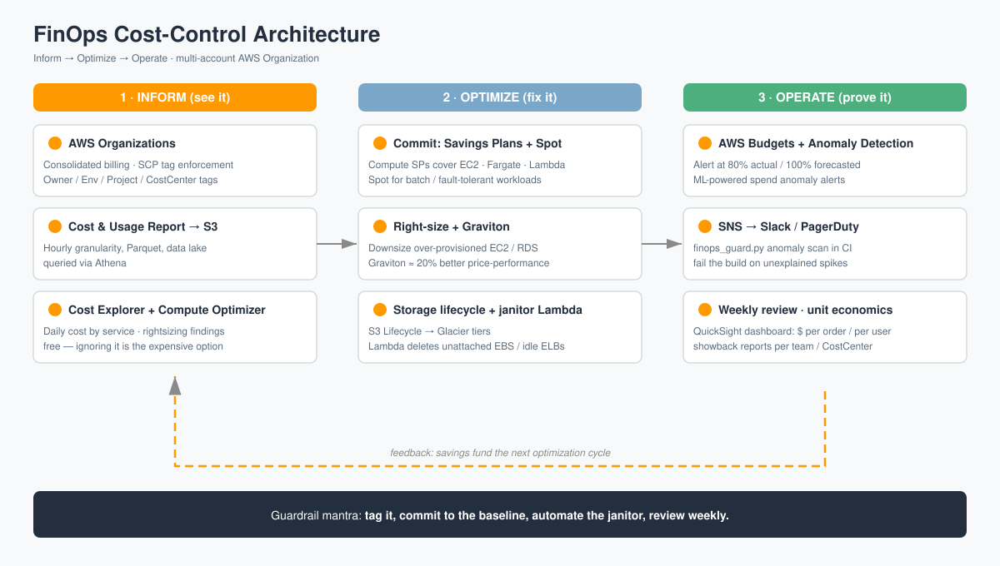

# AWS Cost Optimization & FinOps Playbook 💸


> Cloud bills don't explode overnight. They leak — one unattached EBS volume, one oversized RDS, one forgotten dev account at a time. This guide turns that leak into a loop: **see it → attribute it → fix it → prove it.**

## TL;DR

1. **Tag everything** (owner, env, project) — no tags, no attribution, no accountability.
2. **Commit to your baseline**: Savings Plans for steady compute, Spot for batch, never default On-Demand for everything.
3. **Right-size continuously** — Compute Optimizer is free, ignoring it is expensive.
4. **Automate guardrails**: Budgets + Anomaly Detection + Lambda janitors that kill idle resources.
5. **Review weekly** — FinOps is a habit, not a project.

## The FinOps Loop



```
            ┌──────────────────────────────────────────┐
            │            INFORM (see it)                 │
            │  Cost Explorer · CUR → S3 → Athena         │
            │  Tagging strategy · cost allocation        │
            └───────────────┬──────────────────────────┘
                            ▼
            ┌──────────────────────────────────────────┐
            │         OPTIMIZE (fix it)                  │
            │  Rightsizing · Savings Plans · Spot       │
            │  S3 lifecycle · Graviton · idle cleanup   │
            └───────────────┬──────────────────────────┘
                            ▼
            ┌──────────────────────────────────────────┐
            │          OPERATE (prove it)                │
            │  Budgets · Anomaly Detection · showback   │
            │  Weekly review · unit economics           │
            └──────────────────────────────────────────┘
```

## 💰 Purchase Options: Which Commitment Fits?

| | On-Demand | Spot | Reserved Instances | Savings Plans |
|---|---|---|---|---|
| Discount vs On-Demand | 0% | up to **90%** | up to **72%** | up to **72%** |
| Interruptible? | No | **Yes** | No | No |
| Commitment | None | None | 1 or 3 yr, per instance | 1 or 3 yr, per $/hr |
| Best for | Spiky / unknown | Batch, fault-tolerant | Stable single instance family | Steady compute **across** services |

**Rule of thumb:** cover your *steady-state* baseline with Compute Savings Plans (they apply to EC2, Fargate, and Lambda), use Spot for anything that can die and retry, and keep On-Demand only for true unpredictability.

## 🗄️ S3: Pick the Right Storage Class

| Class | $/GB-mo (us-east-1, approx) | Retrieval fee | Min. storage |
|---|---|---|---|
| S3 Standard | ~$0.023 | none | — |
| S3 Intelligent-Tiering | ~$0.023 + monitoring | none | — |
| S3 Standard-IA | ~$0.0125 | per GB | 30 days |
| S3 Glacier Instant | ~$0.004 | per GB | 90 days |
| S3 Glacier Deep Archive | ~$0.00099 | per GB (hours) | 180 days |

One Lifecycle rule moving untouched objects `Standard → Intelligent-Tiering → Glacier` is the single highest-ROI click in S3.

## 🏷️ Tagging Strategy (the boring part that pays)

| Tag key | Example | Why it matters |
|---|---|---|
| `Owner` | `team-platform` | someone to call when spend spikes |
| `Environment` | `prod` / `dev` / `staging` | kill dev on weekends |
| `Project` | `checkout-v2` | showback per initiative |
| `CostCenter` | `CC-1042` | finance speaks this language |

Enable them as **cost allocation tags** in Billing Console, or they stay invisible in Cost Explorer. Enforce with an SCP: deny `ec2:RunInstances` when required tags are missing.

## ⚡ The 30/60/90 Quick Wins

**Day 1–30 (stop the bleeding)**
- [ ] Turn on Cost Explorer + CUR export to S3
- [ ] Delete unattached EBS volumes & old snapshots
- [ ] Right-size anything Compute Optimizer flags "Over-provisioned"
- [ ] Add Lifecycle rules to your 3 biggest buckets

**Day 31–60 (commit smart)**
- [ ] Buy Compute Savings Plans for your stable baseline
- [ ] Move batch workloads to Spot (EC2 ASG + EMR + Batch)
- [ ] Graviton migration for stateless services (~20% cheaper per perf)

**Day 61–90 (make it stick)**
- [ ] AWS Budgets + Anomaly Detection alerts → Slack
- [ ] Weekly FinOps review with unit economics ($ per order, $ per user)
- [ ] `finops_guard.py` in CI — fail the build on anomaly

## 🧪 Try it: Anomaly Guard in Python

[`finops_guard.py`](finops_guard.py) pulls the last 14 days of cost by service from Cost Explorer, flags any service whose week-over-week spend jumped more than your threshold, and can create an AWS Budget alert — in ~60 lines.

```python
from finops_guard import CostGuard

guard = CostGuard(profile="finops", threshold_pct=20.0)
anomalies = guard.find_anomalies(days=14)
for a in anomalies:
    print(f"🚨 {a.service}: ${a.last_week:.2f} → ${a.this_week:.2f} ({a.change_pct:+.1f}%)")

guard.ensure_budget("monthly-guardrail", limit_usd=5000)  # alert at 80% actual
```

## ❓ Test yourself

Think you can spot the leak? [`quiz.md`](quiz.md) has 5 scenario questions — from "which storage class for 7-year audit logs?" to "Spot vs Savings Plans for a nightly ETL". Answers are collapsed so you can't cheat accidentally. 😉

---

*Built as a daily cloud-engineering write-up. PRs welcome — especially real-world savings numbers.*
